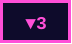
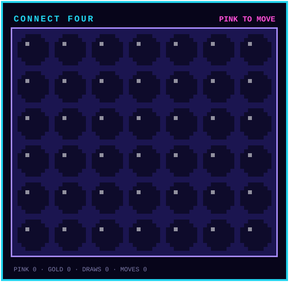

<!-- ↑ ↑ ↓ ↓ ← → ← → B A : you found the secret level. Say hi at sharan071718@gmail.com with the word KONAMI -->

&nbsp;&nbsp;

 
 

  
  

       
       

<!--C4:START-->

      

It is <b>PINK</b>'s turn. Click a column above, then press Submit. 

<b>LAST MOVES and HIGH SCORES</b>

<table><tr><th>Disc</th><th>Move</th><th>Player</th></tr><tr><td colspan="3">No moves yet. Be the first.</td></tr></table>

<table><tr><th>#</th><th>Player</th><th>Moves</th></tr><tr><td colspan="3">Leaderboard is empty.</td></tr></table>

<!--C4:END-->

<picture>
  <source media="(prefers-color-scheme: dark)" srcset="https://raw.githubusercontent.com/Devil1716/Devil1716/output/pacman-contribution-graph-dark.svg" />
  <source media="(prefers-color-scheme: light)" srcset="https://raw.githubusercontent.com/Devil1716/Devil1716/output/pacman-contribution-graph.svg" />
  
</picture>

<b>🕹 SECRET LEVEL</b>

 
You found it. Player 1 ships agents that run on real phones, trains small language models for fun, and answers email fast. <a href="mailto:sharan071718@gmail.com?subject=KONAMI">Send KONAMI</a> and say hi.

<b>📜 PATCH NOTES</b>

 

**v2.0 SSS**: Connect Four you can play from any issue, live language stats, boss fight quest panel, CRT boot on the terminal, premium trophies. 
**v1.0**: pixel room banner and Pac Man battle log.

<b>❔ HOW TO PLAY</b>

 
Click a column arrow in the arcade, press Submit on the issue that opens, and a bot drops your disc within a minute. Pink and gold alternate, so anyone can join either side. Four in a row wins.

