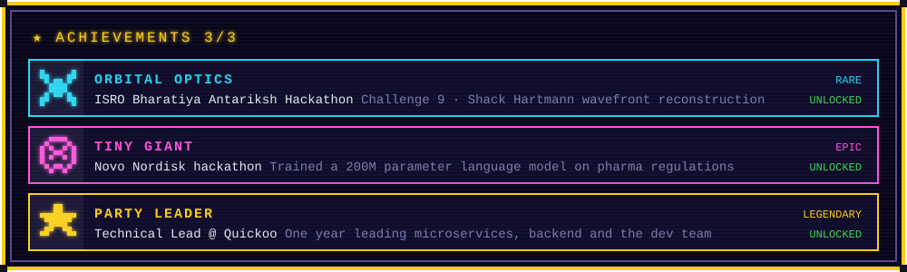
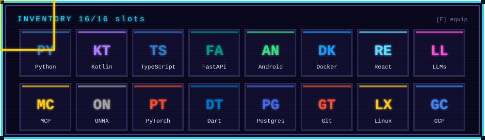

<!-- ↑ ↑ ↓ ↓ ← → ← → B A : you found the secret level. Say hi at sharan071718@gmail.com with the word KONAMI -->

&nbsp;&nbsp;

 
 

  
  

<picture>
  <source media="(prefers-color-scheme: dark)" srcset="https://raw.githubusercontent.com/Devil1716/Devil1716/output/pacman-contribution-graph-dark.svg" />
  <source media="(prefers-color-scheme: light)" srcset="https://raw.githubusercontent.com/Devil1716/Devil1716/output/pacman-contribution-graph.svg" />
  
</picture>

<b>??? secret level</b>

 
You pressed the button. Player 1 ships agents that run on real phones, trains small language models for fun, and answers email fast. <a href="mailto:sharan071718@gmail.com?subject=KONAMI">Send KONAMI</a> and say hi.

