

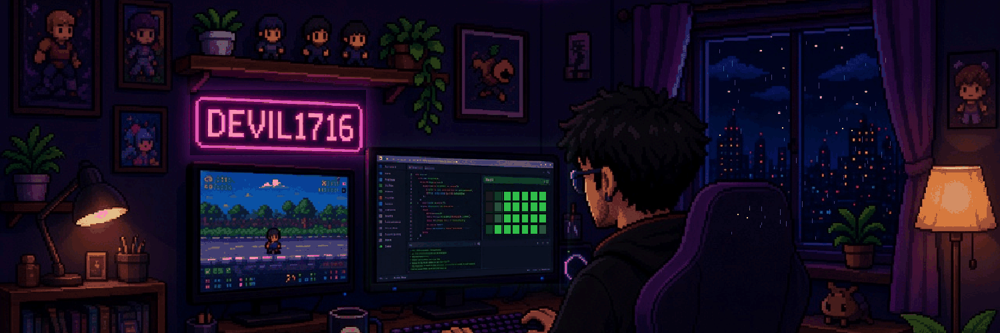

<a href="https://devil1716.github.io"></a>

&nbsp;&nbsp;

<a href="mailto:sharan071718@gmail.com?subject=Recruiting%20player%201">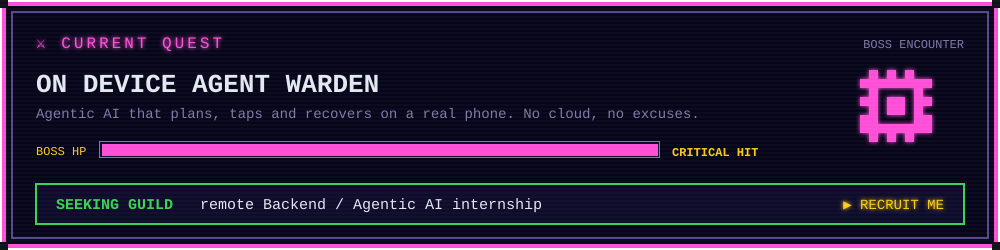</a>

<a href="https://github.com/Devil1716?tab=repositories"></a>

<a href="https://github.com/Devil1716/CognyxOS">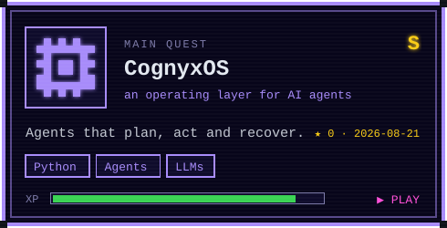</a> <a href="https://github.com/Devil1716/agent-phone-app">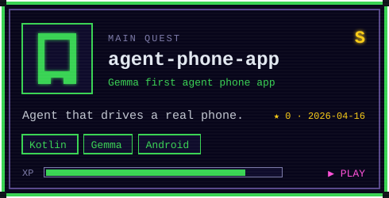</a>
<a href="https://github.com/Devil1716/AgentIDE">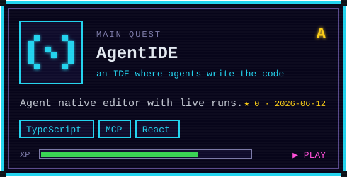</a> <a href="https://github.com/Devil1716/BubbleLab">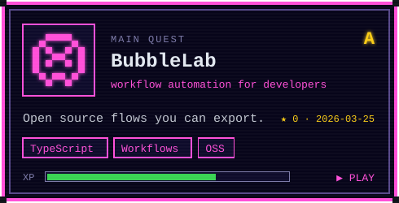</a>

<a href="https://github.com/Devil1716/arbor-dashboard">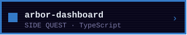</a> <a href="https://github.com/Devil1716/isro-bah-challenge9-shwfs">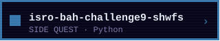</a> <a href="https://github.com/Devil1716/quicko-microservices">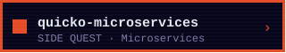</a>
<a href="https://github.com/Devil1716/drapesense">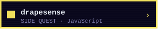</a>  <a href="https://github.com/Devil1716/bluetooth-manet-android">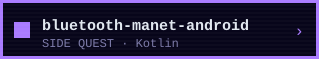</a>

<a href="https://github.com/Devil1716/isro-bah-challenge9-shwfs"></a>
<a href="https://www.linkedin.com/in/sharan-s-171816s/"></a>

<a href="https://www.python.org"></a> <a href="https://kotlinlang.org"></a> <a href="https://www.typescriptlang.org"></a> <a href="https://fastapi.tiangolo.com"></a> <a href="https://developer.android.com"></a> <a href="https://www.docker.com"></a> <a href="https://react.dev"></a> <a href="https://huggingface.co"></a>
<a href="https://modelcontextprotocol.io"></a> <a href="https://onnx.ai"></a> <a href="https://pytorch.org"></a> <a href="https://dart.dev"></a> <a href="https://www.postgresql.org"></a> <a href="https://git-scm.com"></a> <a href="https://kernel.org"></a> <a href="https://cloud.google.com"></a>

<!--ARCADE:START-->

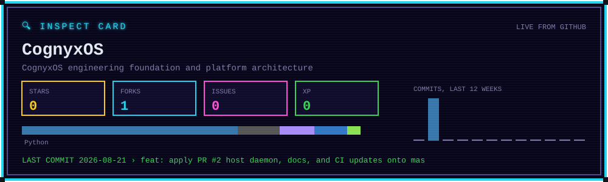

<b>REPO QUEST</b>: pick a repo, press Submit, and its live card loads here.

           

<b>⬆ CHEER A REPO (+10 XP, once a day each)</b>

 

   <a href="https://github.com/Devil1716/Devil1716/issues/new?title=gh%7Ccheer%7Carbor-dashboard&body=Just+press+Submit+new+issue.+The+arcade+bot+does+the+rest.">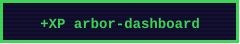</a> <a href="https://github.com/Devil1716/Devil1716/issues/new?title=gh%7Ccheer%7Cisro-bah-challenge9-shwfs&body=Just+press+Submit+new+issue.+The+arcade+bot+does+the+rest.">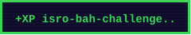</a>      <a href="https://github.com/Devil1716/Devil1716/issues/new?title=gh%7Ccheer%7CHackerRank-Orchestrator&body=Just+press+Submit+new+issue.+The+arcade+bot+does+the+rest.">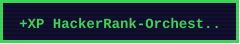</a> 

<!--ARCADE:END-->

<picture>
  <source media="(prefers-color-scheme: dark)" srcset="https://raw.githubusercontent.com/Devil1716/Devil1716/output/pacman-contribution-graph-dark.svg" />
  <source media="(prefers-color-scheme: light)" srcset="https://raw.githubusercontent.com/Devil1716/Devil1716/output/pacman-contribution-graph.svg" />
  
</picture>

<b>❔ HOW TO PLAY</b>

 
1. <b>Inspect</b>: click a repo button under REPO QUEST and press Submit. Within a minute the inspect card shows its live stars, forks, issues, languages, last commit and a 12 week commit chart, and the bot replies with the details. 
2. <b>Cheer</b>: open CHEER A REPO and click one. Each repo takes one cheer per player per day for +10 XP. Every real star is worth +100 XP. 
3. <b>Radar</b>: just watch. It refreshes every day with player 1's latest pushes, PRs and new repos. 
The bot reads only the issue title, then closes the issue.

<a href="#arcade">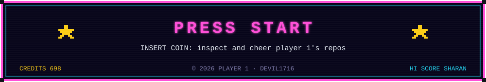</a>

